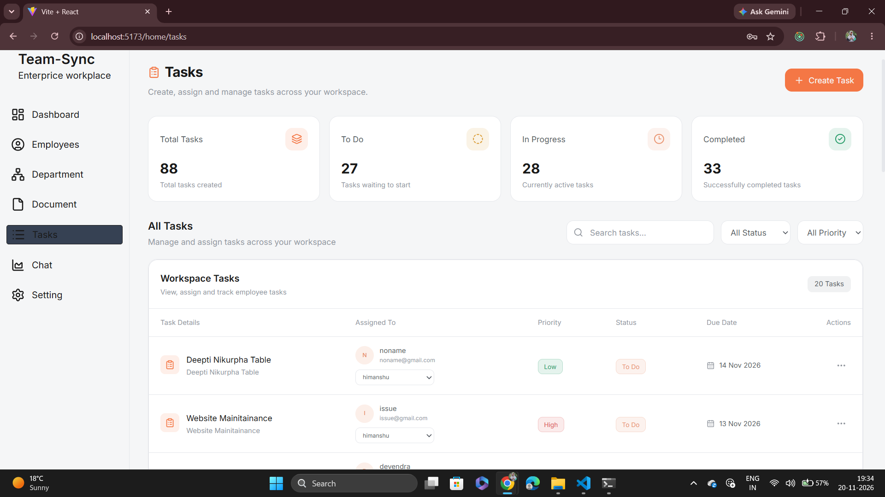
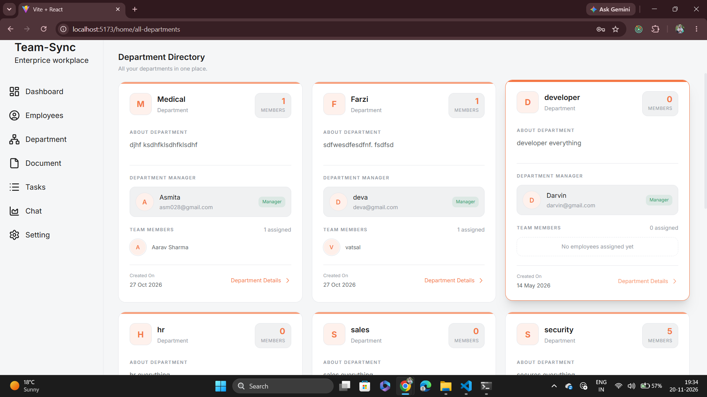
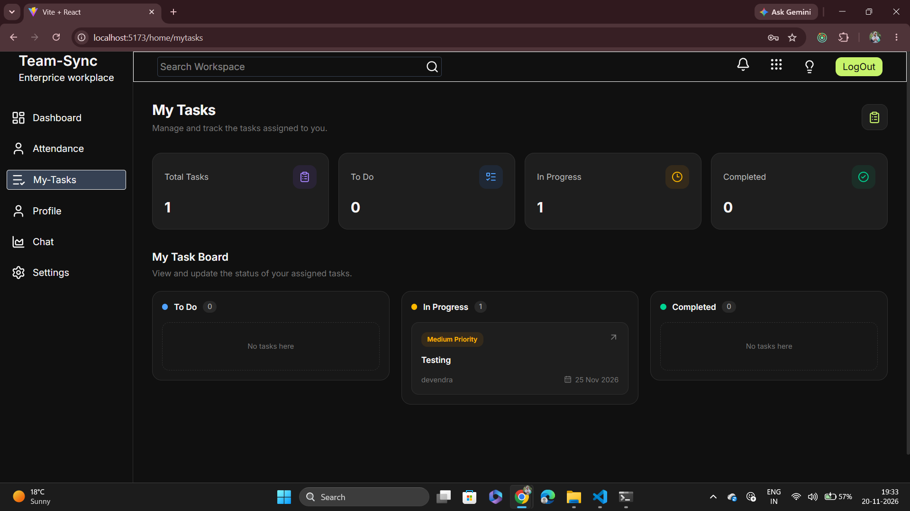
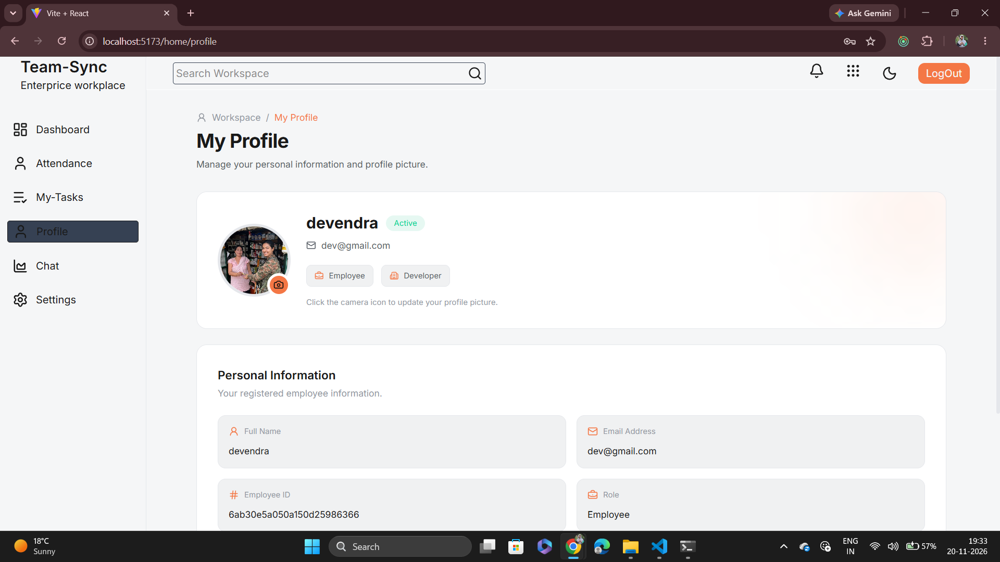

# TEAM SYNC :- Workspace and Task Management Solution

- It is a frontend based project that is created for the big/small teams where we digitally manage the works, daily tasks, projects status, employees with the help of this software/product.

## 🌐 Live Demo

**Frontend:**

## ✨ Key Features

1. Advanced Tools & Fast Development Library : Used React for Faster Development and Redux for state management.
2. Interactive Dashboard : Real-Time data, stats, cards and performanace metrics.
3. Authentication & Role Based Routing : Although I haven't my own backend still built a strong Role based routing and cookies .
4. 4 Layered Architecture & Code Maintainability : For maintaining the code I implemented the 4 layered architecture for every feature.
5. Role-Based Access Control : Implemented the role based access and permission to admin , employee .
6. Fast Data Fetching: Implemented the Tanstack query for Smart Caching and instant ui updates.

## 🛠️ Tech Stack

**Frontend:**

- React.js (Vite)
- Tailwind CSS
- TanStack Query (React Query)
- Axios (with Interceptors)
- Lucide React Icons
- Redux

## 🧠 Challenges Faced & Key Learnings

1. **Role-Based Access Control**
   - **Challenge:** The challenge was how to seprately route the Admin and Employee Aceess?
   - **Solution:** Implmented the AdminRoutes, EmployeeRoutes and CommonRoutes before routing.

2. **Efficient Server-State & Caching**
   - **Challenge:** Managing loading states, pagination limits, and redundant API calls across the dashboard , employee directories and almost in every directory.
   - **Solution:** Replaced manual `useEffect` fetching with **TanStack Query**, using dynamic `queryKey` dependencies for automatic caching and background updates.

## 📸 Screenshots

### 1. Dashboard Overview

### 2. Admin Assigned Tasks

### 3. Department Directory

### 4. My Tasks

### 5. User Profile

## 📁 Folder Structure

src
    │   App.jsx
│   index.css
│   main.jsx
│
├───app
│   │   store.jsx
│   │
│   └───layout
│           DashboardLayout.jsx
│
├───assets
│       react.svg
│
├───config
│       axiosInstance.jsx
│
├───constant
│       navigation.jsx
│
├───features
│   ├───admin module
│   │   ├───departments
│   │   │   ├───apis
│   │   │   │       departmentApis.jsx
│   │   │   │
│   │   │   ├───hooks
│   │   │   │       useDepartmentHook.jsx
│   │   │   │
│   │   │   ├───state
│   │   │   └───ui
│   │   │       ├───components
│   │   │       │       AllDepartment.jsx
│   │   │       │       DepartmentForm.jsx
│   │   │       │
│   │   │       └───pages
│   │   │               Department.jsx
│   │   │
│   │   ├───documents
│   │   │   ├───apis
│   │   │   ├───hooks
│   │   │   ├───state
│   │   │   └───ui
│   │   │       ├───components
│   │   │       │       DocumentContent.jsx
│   │   │       │       documentData.js
│   │   │       │       DocumentStats.jsx
│   │   │       │       DocumentToolbar.jsx
│   │   │       │
│   │   │       └───pages
│   │   │               Documents.jsx
│   │   │
│   │   ├───employees
│   │   │   ├───apis
│   │   │   │       employeeApis.jsx
│   │   │   │
│   │   │   ├───hooks
│   │   │   │       useEmployeesHook.jsx
│   │   │   │
│   │   │   ├───state
│   │   │   └───ui
│   │   │       ├───components
│   │   │       │   ├───add-employee
│   │   │       │   │       AddEmployee.jsx
│   │   │       │   │       AddEmployeeAvatar.jsx
│   │   │       │   │
│   │   │       │   └───employee
│   │   │       │           EmployeeAvatar.jsx
│   │   │       │           EmployeeFilters.jsx
│   │   │       │           EmployeePagination.jsx
│   │   │       │           EmployeeStats.jsx
│   │   │       │           EmployeeTable.jsx
│   │   │       │           EmployeeTableRow.jsx
│   │   │       │
│   │   │       └───pages
│   │   │               Employee.jsx
│   │   │
│   │   └───tasks
│   │       ├───apis
│   │       │       taskApis.jsx
│   │       │
│   │       ├───hooks
│   │       │       useTaskhook.jsx
│   │       │
│   │       ├───state
│   │       └───ui
│   │           ├───components
│   │           │       TaskForm.jsx
│   │           │       TaskPagination.jsx
│   │           │       TaskStats.jsx
│   │           │       TaskTable.jsx
│   │           │       TaskToolbar.jsx
│   │           │
│   │           └───pages
│   │                   Task.jsx
│   │
│   ├───auth
│   │   ├───apis
│   │   ├───hooks
│   │   │       useAuthHook.jsx
│   │   │
│   │   ├───state
│   │   │       authAction.jsx
│   │   │       authSlice.jsx
│   │   │
│   │   └───ui
│   │       └───pages
│   │               Login.jsx
│   │               Register.jsx
│   │
│   ├───chats
│   │   ├───apis
│   │   ├───hooks
│   │   ├───state
│   │   └───ui
│   │       ├───components
│   │       │       chatData.js
│   │       │       ChatDetails.jsx
│   │       │       ChatSidebar.jsx
│   │       │       ChatWindow.jsx
│   │       │
│   │       └───pages
│   │               Chat.jsx
│   │
│   ├───dashboard
│   │   ├───apis
│   │   │       authApi.jsx
│   │   │       dashboardsApis.jsx
│   │   │
│   │   ├───hooks
│   │   │       useDashboardHook.jsx
│   │   │
│   │   ├───state
│   │   └───ui
│   │       ├───components
│   │       │   │   AsideNav.jsx
│   │       │   │   NavigationTab.jsx
│   │       │   │   TopNav.jsx
│   │       │   │
│   │       │   └───dashboardcomp
│   │       │           dashboardData.js
│   │       │           DashboardStats.jsx
│   │       │           DepartmentWorkload.jsx
│   │       │           SectionHeading.jsx
│   │       │           StatCard.jsx
│   │       │           TaskBoard.jsx
│   │       │           TaskCard.jsx
│   │       │           TaskColumn.jsx
│   │       │           TaskProgress.jsx
│   │       │           TodaysTask.jsx
│   │       │
│   │       └───pages
│   │               Dashboard.jsx
│   │
│   ├───employee module
│   │   ├───attendance
│   │   │   ├───apis
│   │   │   ├───hooks
│   │   │   ├───state
│   │   │   └───ui
│   │   │       ├───components
│   │   │       │       AttendanceCalendar.jsx
│   │   │       │       AttendanceHeader.jsx
│   │   │       │       AttendanceHistory.jsx
│   │   │       │       AttendanceStats.jsx
│   │   │       │       TodayAttendance.jsx
│   │   │       │
│   │   │       ├───data
│   │   │       │       attendanceData.jsx
│   │   │       │
│   │   │       └───pages
│   │   │               EmployeeAttendance.jsx
│   │   │
│   │   ├───my tasks
│   │   │   ├───apis
│   │   │   │       employeeTaskApis.jsx
│   │   │   │
│   │   │   ├───hooks
│   │   │   │       useEmployeeTasksHook.jsx
│   │   │   │
│   │   │   ├───state
│   │   │   └───ui
│   │   │       ├───components
│   │   │       │       EmployeeTaskBoard.jsx
│   │   │       │       EmployeeTaskCard.jsx
│   │   │       │       EmployeeTaskColumn.jsx
│   │   │       │       EmployeeTaskDetails.jsx
│   │   │       │       EmployeeTaskHeader.jsx
│   │   │       │       EmployeeTaskStats.jsx
│   │   │       │
│   │   │       └───pages
│   │   │               EmployeeTasks.jsx
│   │   │
│   │   └───profile
│   │       ├───apis
│   │       │       profileApis.jsx
│   │       │
│   │       ├───hooks
│   │       │       useEmployeeProfileHook.jsx
│   │       │
│   │       ├───state
│   │       └───ui
│   │           ├───components
│   │           │       ProfileHeader.jsx
│   │           │       ProfileHero.jsx
│   │           │       profileInformation.jsx
│   │           │
│   │           └───pages
│   │                   EmployeeProfile.jsx
│   │
│   └───settings
│       ├───apis
│       │       settingsApi.jsx
│       │
│       ├───hooks
│       │       useSettingsHook.jsx
│       │
│       ├───state
│       └───ui
│           ├───components
│           │       AccountSettings.jsx
│           │       NotificationSettings.jsx
│           │       ProfileSettings.jsx
│           │       SettingsSidebar.jsx
│           │
│           └───pages
│                   Settings.jsx
│
├───routes
│   │   adminRoutes.jsx
│   │   AppRoutes.jsx
│   │   commonRoutes.jsx
│   │   employeeRoutes.jsx
│   │
│   └───protectedRoutes
│           ProtectedRoute.jsx
│           PublicRoute.jsx
│           RoleBaseRoute.jsx
│
├───screenshots
│       AdminAssignedTasks.png
│       Dashboard .png
│       DepartmentDirectory.png
│       MyProfile.png
│       MyTask.png
│
└───shared
    ├───api
    ├───hooks
    ├───state
    │       themeSlice.jsx
    │
    └───ui

## 👨‍💻 Author

- GitHub: [https://github.com/Fresher-Yogi]
- LinkedIn: [https://www.linkedin.com/in/yogesh-singh-bisht-793585345/]
